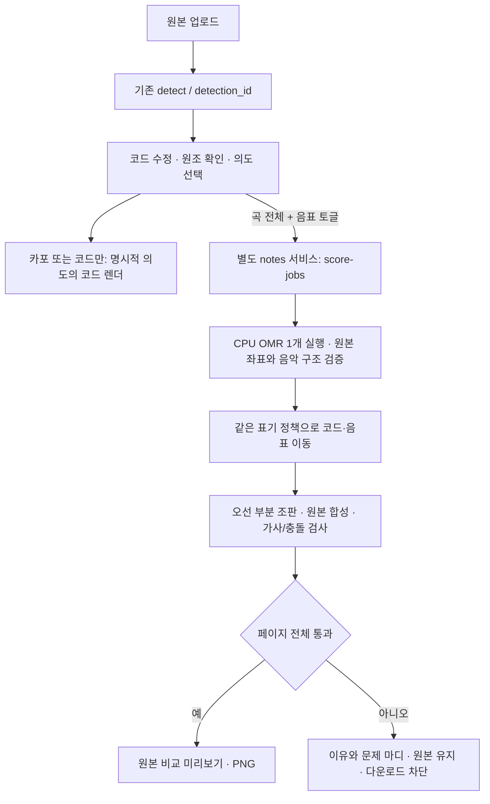

# 오선 음표 조옮김 개발 계획

기준: `main` [`abb0aaa`](https://github.com/Juka526/capomatic/tree/abb0aaad03669cd7c6a879b5212e7c5faff0465c) · 조사일: 2026-10-12 · 상태: **계획 검토용, 구현·출시 미승인**

요청 해석: 코드 기호뿐 아니라 오선의 음표를 옮기는 기능의 가능성·비용·중단 기준을 조사하고, 소유자가 다음 실험을 결정할 수 있는 계획만 제출한다. 이번 변경은 이 문서 한 개다. 제품 코드, 의존성, 배포, 머지 변경은 없다.

## 1. 쉬운 말 요약

카포를 끼우는 것과 노래의 높이를 바꾸는 것은 다릅니다. 카포를 끼울 때는 기타 코드만 바꾸고 음표는 그대로 두어야 합니다. 노래를 실제로 낮추거나 높일 때만 코드와 음표를 함께 옮깁니다.

처음부터 피아노 양손 악보 전체를 지원하기는 어렵습니다. 먼저 **높은음자리표 한 줄에 멜로디 하나만 있는 찬양 악보**를 대상으로, 악보 인식(OMR)으로 음표를 읽고 오선 부분만 다시 그려 원본에 붙이는 방식을 검증하는 것을 권합니다. 한글 가사·제목·크레딧은 원본을 보존하고, 코드와 음표는 같은 조로 맞춥니다. 틀린 음표나 가사 위치 어긋남을 발견하면 완성본 다운로드를 막습니다.

지금 권하는 결정은 구현 착수가 아니라 **라벨 작성과 가능성 실험에 개발자 5~8일, 별도로 악보를 읽는 검수자 2~3인일을 쓰는 것**입니다. 실험이 통과하면 제한된 MVP와 출시 검증에 개발자 18~30일이 더 필요할 것으로 추정합니다. 서버는 기존 서비스와 분리하는 방향입니다. 이번에는 엔진을 실행하지 않았으므로 정확도·속도·메모리 수치는 아직 검증되지 않았습니다. 기준을 못 맞추면 기능을 보류합니다.

소유자가 결정할 사항:

1. **사용자 의도:** `카포용 코드 변경`과 `곡 전체 조옮김`을 구분하는 UI/API를 권합니다. 음수 반음만 보고 카포라고 판단하지 않습니다.
2. **첫 대상:** 단선율 리드 시트만 권합니다. 피아노 양손 악보를 원하는 요청은 이번 MVP로 해결되지 않는다고 안내합니다.
3. **진행 범위:** 우선 Phase 0~1만 승인하는 것을 권합니다. Audiveris를 먼저 검증하고 homr를 비교 후보로 둡니다. 엔진 채택은 정확도와 라이선스 검토 후 결정합니다.
4. **결과물:** 원본 가사·레이아웃을 보존한 PNG를 우선합니다. 완전한 MusicXML 다운로드는 가사와 코드의 음표 연결까지 검증된 뒤 별도로 결정합니다.
5. **품질·비용:** 자동 다운로드 가능 범위가 너무 작거나 서버 분리 비용을 감당하기 어렵다면 보류합니다. AGPL 공개 의무, 저작권, Toss 반영 여부는 소유자와 법률 검토자가 결정해야 합니다.

## 2. 제품 정의와 현재 시스템

### 현재 확인된 사실

[기존 V1 범위](../V1_RELEASE_PLAN.md)는 오선 조옮김을 제외한다. 이 문서는 그 범위를 자동 변경하지 않는 후속 제안이다.

아래는 배포 서버 측정이 아닌 기준 커밋의 코드·파일 조사다. 역사적 문서의 실행 결과는 새 기능의 성능 증거로 재사용하지 않는다.

| 현재 구성 | 새 기능에 주는 조건 |
| --- | --- |
| [`detect_staff_systems`](../../backend/ocr/preprocess.py)는 오선의 위·아래 Y 범위만 반환한다. 2~12개 선 후보를 허용하고 누락 구간을 추정 복원하기도 한다. | 시스템 후보 찾기에는 재사용할 수 있다. 다섯 선 각각의 위치, 기울기, 음자리표, 마디선, 음표 좌표는 별도로 검증해야 한다. 높이를 4로 나눈 간격을 바로 음높이 판정에 쓰면 안 된다. |
| 같은 파일의 `build_chord_bands`는 오선 **위 코드 영역**을 자르고 합친다. | 음표 인식에는 부적합하다. 전체 오선·덧줄·붙임줄이 포함된 원본 좌표의 영역이 필요하며, 기존 코드 OCR의 자르기 규칙은 변경하지 않는다. |
| [`transpose_chord`, `compute_target_key`](../../backend/chords/transpose.py)는 출발·도착 조에 맞춰 글자 이름을 보존하고, 겹임시표나 `E# / B# / Cb / Fb`는 대체 표기로 처리한다. | 음표도 이 규칙과 일치해야 한다. 외부 라이브러리의 기본 이명동음 표기를 그대로 채택하지 않는다. |
| [`render.py`](../../backend/overlay/render.py)는 코드용 Replace/Above, 글자 마스크와 오선 복원, 간격 확보, DejaVu ♭/♯, 키·카포 헤더를 처리한다. | 코드 글자 지우기를 음표 지우기로 확장할 수는 없다. 음표는 기둥·빔·붙임줄 등과 연결된다. 현재 헤더는 −1…−7을 카포로 추론하므로 새 의도 필드가 필요하다. |
| [`main.py`](../../backend/api/main.py): 20 MiB / 50 MP, OCR admission 2, render admission 4, 각 executor worker 1. | admission 수는 병렬 실행 수가 아니다. 각각 실행 중 1개를 포함한 대기 한도다. OMR를 이 executor에 넣지 않는다. |
| detection 캐시: 메모리 LRU, 20개 / 합계 80 MP. TTL 없음. 원본·코드만 캐시하며 반음별 렌더 결과는 캐시하지 않는다. | `detection_id`가 다른 프로세스에서도 원본을 찾아주는 저장소는 아니다. 새 작업의 수명·소유권·전송 규칙을 별도로 둔다. |
| [`transpose-control.mjs`](../../frontend/lib/transpose-control.mjs): 단일 `semitones`, −1…−7은 카포, 범위 밖은 카포 없는 조옮김. | 모드와 반음값을 분리한다. 카포 최대 7, 조옮김 ±11의 기존 범위를 유지한다. |
| [`ISSUE_9_OCR_EVIDENCE.md`](../ISSUE_9_OCR_EVIDENCE.md), [`eval_ocr.py`](../../scripts/eval_ocr.py) | 환경·버전·전체 분모·실패·미충족 조건을 함께 보고하는 방식을 따른다. 코드 라벨은 음표의 정답이 아니다. |

파일 목록을 직접 세면 기준 커밋에는 이미지 **22개**, 코드 라벨 JSON **16개**가 있다. 원래 작업 폴더에는 이미지 26개가 있고, 기준 커밋과 합친 고유 파일은 27개다. 원래 폴더의 `밝음.png` 삭제와 로컬 추가 이미지 때문에 개수가 다르다. 이 작업에서는 기존 파일을 복원하거나 추가하지 않는다. 아래의 기존 8장 후보는 기준 커밋에 있으나, GIFTED의 사용 불허 회신으로 그대로 실행할 수 없다. 음표 정답 라벨도 아직 없다.

### 카포와 실제 조옮김

새 계약은 `intent = capo | key_change`를 필수로 한다. 기존 `/render` 요청의 동작은 호환성을 위해 유지하고, 새 UI에는 명시적 의도를 받는 v2 코드 렌더 계약과 별도 음표 작업 계약을 사용한다. 두 계약은 같은 조옮김 의미를 공유한다.

| 선택 | 요청 예시 | 코드 / 음표 / 조표 | 헤더 예시 |
| --- | --- | --- | --- |
| 카포용 코드 변경 | `intent: capo, capo_fret: 2` | 코드 운지 −2, 음표·조표 0. 실음 D 유지 | `실음: D · 코드 운지: C · Capo: 2` |
| 곡 전체 조옮김 | `intent: key_change, semitones: -2, transpose_notes: true` | 코드·음표 −2, 조표 D→C | `D → C (−2 semitones) · 음표 포함` |
| 코드만 조옮김 | `intent: key_change, semitones: -2, transpose_notes: false` | 코드만 −2, 오선 원조 유지 | `코드: D → C · 음표는 원조 D` |

카포 모드에서 `transpose_notes: true`, 두 종류의 이동값 동시 지정, 범위 초과는 422로 거부한다. `capo_fret=0`과 `semitones=0`은 원조다. 모드를 바꾸면 이동값을 0으로 초기화하고 이전 결과를 무효화한다. 같은 −2라도 자동으로 카포와 조옮김을 전환하지 않는다. 카포와 실제 조옮김을 함께 적용하는 고급 모드는 제외한다.

### 권장 MVP와 음높이 규칙

- 대상: 인쇄된 단일 페이지, 고정 높은음자리표, 한 오선의 단성부 멜로디, 고정 장조 조표, 고정 박자. 한글 가사와 코드가 있는 리드 시트. 일반 쉼표·점음표·빔·붙임줄은 보존해야 한다.
- 제외: 피아노 큰보표, 같은 오선의 여러 성부·동시음, 이조악기, 음자리표/박자/조표 변경, 타악기·타브·손글씨·미분음·꾸밈음·잇단음표·복잡한 반복 구조. 단조·선법은 조·표기 계약을 별도로 검증한 후 확대한다. 지원하지 않는 요소를 포함하면 페이지 전체를 거부한다.
- `children_of_light.png`의 첫 두 시스템에는 동시음/성부가 있고, `온 맘 다해.png`의 세 번째 시스템에는 박자 변경이 있다. 둘은 자동 처리 대상이 아니라 거부 검증 자료다. "한 줄 악보"만으로 지원 여부를 판단할 수 없다.
- 실제 이동은 `출력 MIDI = 원본 MIDI + semitones`다. 양수는 위, 음수는 아래다. **자동 옥타브 이동은 하지 않는다.** 낮춰 달라는 요청을 자동으로 올리지 않는다. 높은음자리표의 덧줄이 어느 음에서든 위/아래 3개를 넘으면 MVP에서는 거부하고 다른 반음값 선택을 안내한다. 음 하나만 접거나 구간마다 옥타브를 바꾸지 않는다. 글자·옥타브 기준으로 덧줄을 계산한다.
- 먼저 원본 조표와 임시표의 마디 내 효력, 옥타브, 붙임줄의 음을 복원한다. 코드에서 추정한 조와 악보의 조표가 다르면 사용자의 원조 확인을 요구한다. 확인 전에는 결과를 만들지 않는다. 조표와 조성은 동일 개념이 아니므로 현재 `infer_key`의 상대장조 결과만으로 단조 지원을 주장하지 않는다.
- 음표 이름은 코드의 글자 이동/대체 표기 규칙과 일치시키되 옥타브는 실제 MIDI 결과에서 구한다. `D→C, −2`에서 B♭4→A♭4, C♯5→B4, 코드 A/C♯→G/B가 일치해야 한다. F♯ 장조의 E♯처럼 코드 규칙이 F로 대체하는 음은 F♮와 옥타브를 정확히 적고 조표·임시표를 재계산한다. 이 정책의 가독성도 음악 검수 대상이다.
- MusicXML의 `step/alter/octave`를 바꾸고 조표·임시표를 다시 계산한다. `<transpose>`만 추가하는 것은 이조악기의 기보음/실음 관계를 표현하는 것이므로 이 기능의 구현이 아니다. [음높이 규격](https://www.w3.org/2021/06/musicxml40/musicxml-reference/elements/pitch/), [transpose 규격](https://www.w3.org/2021/06/musicxml40/musicxml-reference/elements/transpose/).

### 출력의 필수 조건

한글 가사 전체, 음절과 해당 음표의 연결, 코드의 박 위치, 제목, 크레딧이 살아 있어야 한다. 음표를 옮기면서 원래 코드까지 그대로 남기는 것은 실패다. 권장 PNG는 가사·제목·크레딧 보호 영역의 디코딩된 RGB를 원본과 동일하게 유지하고, 코드는 검증된 새 코드로 교체한다. 어떤 음표나 줄도 가사/코드 위에 겹칠 수 없다. 장식·구조 표식도 삭제하지 않는다.

MusicXML은 내부 교환 형식으로 먼저 사용한다. 가사·제목·크레딧·코드가 빠진 XML을 완성 악보로 다운로드시키지 않는다. 한국어 문자열의 보존과 `<lyric>`의 음표 연결은 별도 조건이다. [MusicXML lyric 규격](https://www.w3.org/2021/06/musicxml40/musicxml-reference/elements/lyric/).

## 3. 접근법 비교

아래 품질·공수는 **코드/공식 자료/악보 육안 검토에 따른 가설**이며 우리 자료에 대한 엔진 측정값이 아니다. 공수는 익숙한 개발자 1명의 MVP 구현 일수로, 공통 Phase 0~1·출시 검증은 별도다.

| 접근 | 우리 악보의 예상 품질·보존 | CPU·의존성 비용 | 라이선스 | 구현 공수 추정 | 주요 실패 / 사용자 처리 |
| --- | --- | --- | --- | --- | --- |
| 1. 원본 음표를 찾아 직접 지우고 이동 | 단순 단음은 가능성이 있으나 빔·기둥·붙임줄이 얽힌 찬양 악보에서는 취약. 보호 마스크 밖 가사/제목은 픽셀 보존 가능 | 기존 영상 도구 재사용. 인식기를 직접 만들면 비용·기간이 크게 증가. 엔진 없는 정확한 CPU 추정은 불가 | 직접 작성 코드와 실제 사용 영상 라이브러리의 조건 확인 | 30~50일 이상 | 음표만 이동하면 기둥·빔 방향, 덧줄, 조표·임시표가 틀림. 연결 요소 하나라도 분리 불확실하면 원본 표시, 페이지 다운로드 차단 |
| 2. OMR → MusicXML → 조옮김 → 전체 재조판 | 음악 구조가 정확하면 깨끗함. 원본 레이아웃은 바뀜. 인식되지 않은 한글이나 음절 연결은 복구되지 않음 | 엔진 + XML 도구 + 조판기. 대체로 인식이 지연을 지배할 것으로 예상, 실제 비율 측정 필요 | 엔진 AGPL/MIT, 조판기 LGPL/GPL 등 조합 검토 | 15~25일, 가사 편집기 필요 시 별도 재산정 | 빠진 가사·크레딧·잘못된 음절 연결이 있으면 미리보기 경고와 다운로드 차단. 사용자가 전부 다시 입력해야 하면 MVP 보류 |
| 3. OMR 구조를 이용한 원본 부분 재조판·합성 **우선 실험** | 인식된 음·마디를 원래 자리와 맞춰 오선 영역만 교체. 한글 OCR 없이 원본 텍스트 보존 가능성이 가장 큼. 정렬 성공은 아직 미확인 | 엔진 비용은 2와 비슷하고, 좌표 검증·마스크·합성 추가. 기존 OCR와 서버 분리 | 엔진/조판기 조건은 그대로 적용, 합성한다고 사라지지 않음 | 15~25일, 좌표 고정이 안 되면 중단 | 마디 폭만 맞춰도 음절과 음표가 어긋날 수 있음. 음표 시작점 단위로 원본 좌표와 대응하고 충돌 검사. 좌표·보호 영역 불확실 시 페이지 전체 차단 |

권장 실험은 3번 중 **오선 부분 재조판**이다. OMR 좌표로 음표를 한 개씩 지우는 변형은 1번의 빔/붙임줄 문제를 그대로 가진다. Audiveris의 원본 심볼 좌표와 출력 이벤트가 안정적으로 대응되는지 먼저 확인한다. 마디 양끝만 늘려 맞추거나 MusicXML 좌표가 조판기에 그대로 반영된다고 가정하지 않는다. 각 음절의 연결 음표, 코드의 시작 박, 붙임줄 양끝까지 맞아야 한다. 새 조표 폭·줄바꿈이 기존 영역을 벗어나거나 가사와 겹치면 그 페이지는 지원하지 않는다.

2번은 비교 출력으로 측정한다. 3번이 실패해도 가사 보존 조건을 낮춰 2번으로 자동 전환하지 않는다. 완전 재조판에서 텍스트·음절 연결까지 통과했다는 증거가 있을 때만 소유자가 방향을 다시 결정한다.

## 4. 엔진·라이브러리 평가와 라이선스

2026-10-12 공식 저장소·라이선스·handbook을 확인했다. 웹에 표시된 release/history는 아래 날짜까지 활동했다는 증거이며 지원 보장이 아니다. spike 시작 시 정확한 tag/SHA와 모델 해시를 고정한다. 모든 한국어 적합성 평가는 **아직 실행 미검증**이다.

| 후보 | 라이선스 · 유지보수 근거 | 런타임 · 우리 용도 판단 |
| --- | --- | --- |
| **Audiveris, 1순위 spike** | [AGPLv3 LICENSE](https://raw.githubusercontent.com/Audiveris/audiveris/master/LICENSE), [5.11.0, 2026-07-11](https://github.com/Audiveris/audiveris/releases/tag/5.11.0), [8월까지 commit](https://github.com/Audiveris/audiveris/commits/master/) | [5.11.0 설정](https://raw.githubusercontent.com/Audiveris/audiveris/5.11.0/gradle.properties)의 최소 Java **25**. 인쇄 악보→MusicXML, native OCR 포함. `.omr`의 원본 심볼 정보가 hybrid 후보인 이유이나 픽셀 마스크의 정확성은 별도 확인 |
| **oemer** | [MIT LICENSE](https://raw.githubusercontent.com/BreezeWhite/oemer/main/LICENSE), [v0.1.8, 2024-11-16](https://github.com/BreezeWhite/oemer/releases/tag/v0.1.8), [이후 README 변경](https://github.com/BreezeWhite/oemer/commits/main/) | Python/ONNX. [setup.py](https://raw.githubusercontent.com/BreezeWhite/oemer/main/setup.py)는 Linux에서 `onnxruntime-gpu`를 선택하므로 CPU 설치 경로 검증 필요. 정확한 Python 범위 미선언, 3.12 호환 미검증. [README](https://github.com/BreezeWhite/oemer)는 homr를 개선판으로 안내. 최근 유지보수 빈도가 낮은 MIT 비교 후보 |
| **homr, 비교 후보** | [AGPL-3.0 LICENSE](https://raw.githubusercontent.com/liebharc/homr/main/LICENSE), [2026-09-02 commit 등](https://github.com/liebharc/homr/commits/main/) | [pyproject](https://raw.githubusercontent.com/liebharc/homr/main/pyproject.toml): Python ≥3.11,<3.16, CPU ONNX extra. Torch는 개발/학습 의존성이므로 serving 필수라고 쓰지 않는다. [README](https://github.com/liebharc/homr)는 pitch/rhythm 중심, `imgpos` 근사 좌표임을 명시. Releases의 benchmark bucket을 앱 버전으로 쓰지 않고 commit 고정 |
| **Verovio, 조판 첫 후보** | [LGPL-3.0](https://github.com/rism-digital/verovio/blob/develop/COPYING.LESSER), [6.3.0, 2026-08-19](https://github.com/rism-digital/verovio/releases) | C++/Python/JS, MusicXML import→MEI→SVG. [Python 설치](https://book.verovio.org/installing-or-building-from-sources/python.html). PNG에는 rasterizer가 추가로 필요. 원본 x 좌표 보존은 보장하지 않음 |
| **music21, 변환 도구 후보** | 코드 [BSD-3-Clause](https://github.com/cuthbertLab/music21/blob/master/LICENSE), [v10.5.0, 2026-06-17](https://github.com/cuthbertLab/music21/releases) | Python의 MusicXML 분석/변환 도구로 조판기 자체가 아님. 현재 [README](https://github.com/cuthbertLab/music21)는 Python 3.12+이며 stable tag의 조건을 다시 고정. [corpus](https://music21.org/music21docs/about/about.html)는 비상업 조건 등 개별 권리가 있어 서비스 이미지에 포함하지 않는 설치 경로를 확인 |
| **LilyPond** | [GPL-3.0-or-later 소스 고지](https://raw.githubusercontent.com/lilypond/lilypond/master/lily/main.cc), [stable 2.26.0 / 개발판 활동](https://lilypond.org/news.html) | Guile/font/native stack의 CLI 조판기. MusicXML 변환 후 PDF/SVG/PNG 생성 경로 검증. [FontConfig/Pango 설명](https://lilypond.org/doc/v2.26/Documentation/notation/fonts.html)에 따라 정적 한글 font를 명시하고 glyph/줄바꿈 확인 |
| **MuseScore Studio CLI** | [v4.7.5 GPL-3.0-only 및 font 예외](https://raw.githubusercontent.com/musescore/MuseScore/v4.7.5/LICENSE.txt), [4.7.5, 2026-09-08](https://github.com/musescore/MuseScore/releases) | Qt 기반 앱의 [변환 CLI](https://handbook.musescore.org/appendix/command-line-usage), `-o`/`-j`. headless plugin/font 구성 필요. 음원팩을 제외한 비교 조판기로 검토. 과거 MuseScore 버전의 GPLv2 정보를 적용하지 않음 |

추가 OMR를 무한 탐색하지 않는다. 첫 실험은 Audiveris, geometry/인식 문제가 있을 때 homr까지 최대 2개로 제한한다. oemer는 MIT 대안이 필요하면 homr를 **대체**하는 두 번째 후보로만 비교한다. 세 번째 엔진은 별도 실험 결정이 필요하다. oemer도 한글·품질 조건을 통과하지 못하면 라이선스가 쉽다는 이유로 채택하지 않는다.

### 한글과 의존성 크기

Audiveris의 CJK UI 지원은 한글 가사 인식 보장이 아니다. [OCR 언어 설정](https://audiveris.github.io/audiveris/_pages/guides/main/languages/)에 맞는 `kor+eng` traineddata를 설치하고 `<lyric>` 내용·연결·제목·크레딧을 검사해야 한다. [oemer XML 생성부](https://raw.githubusercontent.com/BreezeWhite/oemer/main/oemer/build_system.py)와 [homr XML 생성부](https://raw.githubusercontent.com/liebharc/homr/main/homr/music_xml_generator.py)에서는 가사 출력 경로를 확인하지 못했다. homr의 [제목 OCR](https://raw.githubusercontent.com/liebharc/homr/main/homr/title_detection.py)은 가사 전체 인식과 다르다. 이는 소스 기반 판단으로, 두 엔진의 원시 XML만으로 가사 요구사항 충족을 주장할 수 없다.

Verovio의 [SMuFL/font 지원](https://book.verovio.org/advanced-topics/smufl.html)은 음악 기호에 대한 설명이다. 한글이 자동 포함된다고 가정하지 않는다. music21은 문자 데이터를 옮기지만 실제 glyph는 조판기/font 책임이다. [MuseScore 가사](https://handbook.musescore.org/text/lyrics)와 LilyPond의 문자 지원도 한국어 입력→내보내기 정확도와 별개다. 각 조합에서 NFC/NFD, 음절 붙임, 멜리스마, 줄바꿈, SVG→PNG를 비교한다. 기존 DejaVu의 ♭/♯ 지원은 한글/전체 악보 font를 해결하지 않는다.

| 후보 | 공식 다운로드 크기 또는 계획용 증가 예산 | CPU/RAM 판단 |
| --- | --- | --- |
| Audiveris | [5.11.0 Linux .deb](https://github.com/Audiveris/audiveris/releases/expanded_assets/5.11.0) 74.1~74.4 MB **압축 파일**. [설치 문서](https://audiveris.github.io/audiveris/_pages/tutorials/install/binaries/)상 JRE 포함, OCR 언어 별도. Python slim에 Ubuntu 패키지 호환은 미검증. 별도 Ubuntu worker 이미지 후보 | [2019년 maintainer 설명](https://github.com/Audiveris/audiveris/issues/285)의 당시 약 30초/페이지를 오래된 규모 기준점으로만 사용. `30초 × 1~4 + 기동/텍스트 0~60초` = **30~180초/페이지**의 실험 예산. 현재 HF 성능 예상치로 확정하지 않음 |
| oemer | [ONNX checkpoint](https://github.com/BreezeWhite/oemer/releases/expanded_assets/checkpoints) 67.5+36.7 = **104.2 MB**, runtime wheel/이미지 제외 | CPU 시간/RSS 불명. README의 GPU 3~5분을 CPU 측정으로 전용 금지. Linux GPU wheel의 디스크 비용도 별도 측정 |
| homr | [ONNX assets](https://github.com/liebharc/homr/releases/expanded_assets/onnx_checkpoints)의 encoder 46 MB, decoder 35.8 MB. segmentation 모델·OCR 모델은 선택 버전별 추가 | CPU 시간/RSS 불명. [모델 config](https://raw.githubusercontent.com/liebharc/homr/main/homr/transformer/configs.py)와 download 버전을 고정. 모든 release asset을 설치 크기로 합산하지 않음 |
| Verovio / music21 | 기존 Python base 대비 각각 **0.1~0.3 / 0.1~0.4 GiB** 증가 예산 | 작은 native wheel 또는 Python 과학 라이브러리 + font/rasterizer를 고려한 넓은 **추정**, 실측 아님 |
| LilyPond / MuseScore CLI | 각각 **0.3~0.8 / 0.5~2 GiB** 증가 예산 | native font/Guile 또는 Qt/support data를 고려한 **추정**, 음원팩 제외. 전체 이미지 크기/메모리와 혼동 금지 |

Audiveris 배포 런처는 [5.7.0부터 max heap 8 GB](https://github.com/Audiveris/audiveris/releases/tag/5.7.0)로 변경됐다. 실제 사용 메모리가 8 GB라는 뜻은 아니다. `최대 heap 8 + native/영상 여유 2 = 10 GiB`를 초기 용량 예산으로 잡고 §6에서 컨테이너 peak를 측정한다. 필요한 heap 상한은 결과를 보기 전 설정 manifest에 남긴다. 이 규모를 기존 Paddle 프로세스와 한 Space에 합치지 않는다. 계산 예산은 임시값이며 측정이 나쁘면 실패로 보고한다.

### 네트워크 서비스의 공개 의무: needs legal check

- **GPL:** 네트워크로 기능만 제공하는 것과 프로그램 사본을 배포하는 것은 다르다. GPLv3 §0/§6상 네트워크 이용만으로 일반적인 소스 제공 의무가 생기는 것은 아니지만, covered binary/container를 전달하면 해당 covered work의 Corresponding Source를 허용된 방식으로 제공하고 고지·라이선스를 유지해야 한다. 변경 소스와 필요한 빌드/설치 자료도 검토한다. 공개 저장소 링크 하나만으로 충족을 단정하지 않는다. [GPLv3](https://www.gnu.org/licenses/gpl-3.0.html).
- **AGPL:** §13은 수정한 네트워크 상호작용 버전의 원격 사용자에게 그 버전의 Corresponding Source를 무상으로 받을 방법을 눈에 띄게 제공하도록 한다. §1의 소스 범위와 결합 저작물 해당 여부에 따라 어댑터/결합 부분까지 포함될 수 있다. 앱 전체를 무조건 공개해야 한다거나, 수정하지 않은 CLI 호출이면 검토가 불필요하다고 단정하지 않는다. 해당 버전·수정 내용·연동 방식·바이너리 제공 여부를 확인해야 한다. [AGPLv3 §§1,13](https://www.gnu.org/licenses/agpl-3.0.html).
- **별도 서비스:** JSON/MusicXML을 주고받는 독립 프로그램인지, 내부 데이터 구조와 결합되어 하나의 프로그램인지가 쟁점이다. 컨테이너·별도 HF Space·HTTP 분리만으로 의무가 사라지지 않는다. 실제 IPC와 소스 경계를 법률 검토자에게 제공한다. [FSF 결합/집합 FAQ](https://www.gnu.org/licenses/gpl-faq.en.html#MereAggregation), [AGPL Corresponding Source FAQ](https://www.gnu.org/licenses/gpl-faq.en.html#AGPLv3CorrespondingSource).
- **LGPL/BSD/MIT:** Verovio를 배포하는 방식은 LGPL의 결합·재결합 조건을 확인한다. 향후 브라우저 WASM은 서버 실행과 달리 이용자에게 코드 사본을 전달한다. BSD/MIT도 해당 고지를 유지하며 weights·font·corpus 권리는 별도다. 조판 출력이 자동으로 GPL이 된다고 단정할 수 없고, underlying 악보/가사의 저작권도 별개다. [LGPL §4](https://github.com/rism-digital/verovio/blob/develop/COPYING.LESSER), [GPL §2](https://www.gnu.org/licenses/gpl-3.0.html).

법률 검토 결과물은 “이 버전/수정/연동에서 무엇을 공개해야 하는가”를 파일·빌드 자료·제공 화면 단위로 적은 목록이어야 한다. 서비스 소유자가 공개 범위를 수용할지 결정한다. 미해결이면 외부 beta를 중단하며, 프로세스 분리로 우회했다고 결론내리지 않는다. 이 문서는 법적 허용 여부를 결정하지 않는다.

## 5. 사전등록 정확도 게이트

**등록 상태: 임계값·선정 규칙 고정, 실행 전제 미충족.** 이용권이 확인된 8장·정답 라벨·해시 manifest·엔진 고정 버전·독립 검수자가 아직 없어서 현재 판정은 **NOT RUN**이다. 결과를 본 뒤 임계값이나 분모를 낮추지 않는다. [`ISSUE_9_OCR_EVIDENCE.md`](../ISSUE_9_OCR_EVIDENCE.md)의 실패 공개 원칙과 기존 G5 사전등록의 "표본 부족도 통과 아님, OOS를 보고 재조정하지 않음" 원칙을 적용한다. G5의 금융 지표나 숫자를 음악 평가에 옮기지는 않는다.

### 정답 자료와 독립성

| 묶음 | 자료·고정 범위 | 용도 |
| --- | --- | --- |
| 개발/회귀 6장 | 권리가 확인된 단선율 악보 6장, 각각 첫 **3개 인쇄된 음악 시스템**. 기존 후보 중 `hey_buddy`(친구야)는 제외. 나머지도 권리 확인 전 실행 금지 | 파서·좌표 매핑·렌더 규칙 개발. 엔진 결과에 맞춘 자료/시스템 선택 금지 |
| 잠금 평가 2장 | 개발자에게 출력/라벨이 공개되지 않은, 별도로 권리 확인한 악보 2장, 각각 첫 3개 음악 시스템 | 선택한 설정 1개만 최종 평가. 기존 코드 OCR에 노출된 fixture를 외부 미지 자료라고 부르지 않음 |
| 거부 평가 | 직접 만든 단일 오선 다성부·박자 변경·큰보표·음자리표 변경·가사 충돌 예제 | 기존 악보에서 발견한 실패 구조만 재현하고 음악/가사를 복제하지 않음 |
| 공개 가능 대조군 | New Britain 선율의 새 단선율 조판 1장 + 직접 작성한 한국어 테스트 음절 | 공개 전후 이미지와 문자열/음절 연결 검사. 역사적 원곡과 현대 편곡·번역의 권리는 구분 (§8) |

**자료 선정 잠금은 아직 미완료다.** 2026-10-12 소유자가 전달한 회신에서 GIFTED 공식 악보 활용과 기존 ‘친구야’ 안내 영상 사용이 불허되었다. 따라서 `hey_buddy`를 포함한 GIFTED 악보는 평가·spike·가이드에서 제외한다. 다른 fixture도 출처/허가를 확인하지 않은 채 엔진에 넣지 않는다. Phase 0에서 허용된 8장의 파일명·출처·권리 근거·SHA·개발/잠금 배정을 먼저 고정해야 실행할 수 있다. 현재 파일에 대한 육안 관찰은 인식 성공 증거가 아니며 이 대체 절차를 생략하는 근거도 아니다.

Phase 1의 평가 단위는 **원본 한 장의 첫 3시스템을 자른 스니펫**이다. 8장 × 3시스템을 고정하며, 스니펫 밖 음표에는 정확도 판정을 하지 않는다. 아래 표의 수용/coverage도 이 스니펫의 자동 분류·로컬 PNG 출력만 뜻한다. 이를 원본 전체 페이지의 다운로드 안전성으로 해석하지 않는다. 전체 페이지 다운로드는 Phase 3의 전 시스템 라벨/검증을 통과한 뒤에만 공개한다. 제목·크레딧이 crop 밖에 있으면 별도 보호 영역 픽셀 검사는 할 수 있으나, crop 밖 음절 연결 검증을 통과했다고 보고하지 않는다.

8개 스니펫에 최소 **500개의 유효한 발음 음표 이벤트**가 있어야 한다. 미달이면 `INSUFFICIENT_SAMPLE`로 기록하고 실행 전 새 사전등록을 작성한다. 보기 쉬운 음만 골라내지 않는다. 지원 제외 요소가 발견되면 사유와 영역을 기록하고 그 페이지를 임의 대체하지 않는다. 음표 외 쉼표·박자·마디·가사도 라벨에 포함한다.

최소 JSON 계약은 `source_sha256, page, system, measure, event_index, onset, duration, step, alter, octave, midi, rest, tie, key_fifths, time_signature, bbox, lyric_anchor, chord_anchor`다. onset/duration은 부동소수 대신 유리수다. 못갖춘마디, 점음표, 붙임줄, 반복 표식도 명시한다. XML을 함께 만들더라도 이미지에서 직접 판독한 JSON이 정답이다.

음악 판독자 A가 이용권이 확인된 원본으로 라벨링하고 B가 엔진 출력 없이 독립 판독한다. 차이는 원본·수동 건반 확인으로 조정한다. OMR 결과, 기존 코드 기반 조 추정, 조옮김 구현의 출력을 정답 초안으로 쓰지 않는다. 예상 공수: 24시스템 첫 판독 6~10시간, 독립 검수·조정 5~8시간, 좌표/manifest·정답 검증 3~5시간, 합계 14~23인시간. 실제 소요도 기록한다.

잠금은 두 번 한다. **개발 실험 전 잠금 A**: 이용권·파일/크롭/라벨 해시, 개발/잠금 분할, 임계값/분모, 후보 최대 2개, 시간제한과 실험 예산, 기록 양식을 commit한다. 개발 6개 스니펫에서만 엔진 설정·좌표 대응 허용값·confidence 규칙을 결정한다. **잠금 평가 전 잠금 B**: 최종 단일 엔진/모델, preprocessing·언어·seed, scorer 코드/정렬 허용값, 자동 수용 규칙과 전체 manifest의 SHA-256을 commit한다. B 이후 잠금 2개 스니펫에서 설정 선택이나 튜닝을 하지 않는다. A/B 사이에도 이 문서의 임계값은 바꾸지 않는다.

정답 기대값은 별도 검수자가 수동 음정 계산으로 만든다. 구현의 조옮김 함수를 정답 생성기나 자기 검증기로 사용하지 않는다. 고정된 서비스 로직이 정답 라벨을 보기 **전에** 각 결과의 수용/거부를 분류해 로그를 봉인한다. 수동 음표 수정·정답을 보고 정한 제외/수용은 raw 지표뿐 아니라 silent-error·coverage에서도 전부 금지한다. 기존 UI의 코드 교정은 허용하되 잠금 A에서 원본 기준으로 확정한 코드 snapshot만 쓰고, 엔진/변환 결과를 본 뒤 수정하지 않는다. 이 평가는 음표 인식 평가이며 기존 코드 OCR 정확도는 별도로 기록한다.

거부 묶음은 **16유형 × 2개 = 32개**의 직접 만든 예제로 고정한다: 큰보표, 단일 오선 다성부/동시음, 이조악기, 음자리표 변경, 박자 변경, 조표 변경, 타악기, 타브, 손글씨, 미분음, 꾸밈음, 잇단음표, 복잡한 반복, 단조/선법, 덧줄 초과, 가사/코드 충돌. 잠금 A에 각 이미지·예상 거부 이유·해시를 기재하고 엔진 결과를 보고 교체하지 않는다. 악기/조성을 이미지에서 판별할 수 없는 경우도 불확실 입력으로 거부하는 예제를 포함한다. 32개가 준비되지 않으면 NOT RUN이며, 유형별 미준비/미검증을 공개한다. 이 작은 묶음이 모든 비지원 입력을 포괄한다는 주장은 하지 않는다.

### 고정 지표와 통과 문턱

정렬은 스니펫→시스템→마디→왼쪽에서 오른쪽 이벤트 순서로 고정한다. 대응은 독립 라벨의 원본 x 위치와 엔진의 원본 심볼 위치를 사용하며, 음높이/길이를 맞추도록 정렬을 최적화하지 않는다. 이벤트 간 대응 비용·거리 허용값은 개발 자료에서 정하고 잠금 전에 scorer에 고정한다. 위치가 없는 엔진은 마디 내 순번으로 비교하며 삽입/누락을 오류로 센다. 이런 엔진은 hybrid 좌표 게이트를 통과했다고 할 수 없다.

`N`은 정답 음표 수, `FP`는 대응 없는 추가 음표 수다. 피치 정확도는 `정확한 MIDI 대응 수 / (N + FP)`이며 누락·옥타브 오류도 오답이다. 리듬은 쉼표를 포함한 이벤트에 대해 같은 분모 방식으로 onset·duration·tie가 모두 맞아야 정답이다. 합계 점수와 스니펫별 최저 점수를 함께 보고한다.

| 항목 | 고정 통과 조건 |
| --- | --- |
| 원본/변환 후 조표 | 평가 대상 모든 시스템의 조표와 취소 임시표 **100% 정확**. 장조 확인 실패는 거부로 계수 |
| 원본 피치 | 전체 **≥99.5%**, 각 스니펫 **≥99%**; note 삽입·누락·옥타브를 포함 |
| 원본 리듬 | 전체 **≥99%**, 각 스니펫 **≥98%**; 모든 마디의 총 길이는 박자/못갖춘마디 정답과 정확히 일치 |
| 마디 수·순서·구조 | 스니펫별 **100% 일치**. 반복은 재생 순서로 펼치지 않고 인쇄된 순서로 비교 |
| 조옮김 | `−11, −7, −2, 0, +1, +5, +11` 모두 평가. 수용한 결과의 MIDI·옥타브·표기·조표·코드의 일치 **100%**; 덧줄 제한 거부는 coverage에 반영 |
| 가사·제목·크레딧·코드 | 수용한 모든 결과에서 내용/음절/박 연결 **100%**, 보호 픽셀 변경 0, 겹침/지워진 비음표 표식 0. 전체 재조판은 픽셀 동일 대신 독립 문자열·연결·내용 전수 대조 |
| 알리지 않은 잘못된 음 | 자동 수용한 스니펫 결과에서 틀리거나 누락/추가된 음 **0개**, 오류 스니펫 **0개**. 음 단위 `오류/(N+FP)`와 스니펫 단위 `오류 스니펫/수용 스니펫`을 모두 보고 |
| 거부만 해서 통과하는 것 방지 | 8개 스니펫 × 위 7개 이동값 = 56개 요청 중 **≥80%** 자동 수용. 잠금 2개 스니펫 × 7개에서도 ≥80%. 비지원 음역·충돌 거부도 분모에 포함; 0개 수용은 실패 |
| 비지원 구조 탐지 | 고정된 거부 묶음 32개 중 잘못 수용한 예제 **0개**, 이유/유형별 결과 공개 |

위 모든 조건을 동시에 만족해야 Phase 1 통과다. 엔진 A가 실패하고 B가 통과하면 각각의 전체 결과를 남긴다. 개발 자료에서만 최대 2개 엔진을 비교하고 설정을 선택한다. 잠금 자료는 선택한 엔진/설정 한 번만 평가한다. 실패 후 수정하면 잠금 자료도 개발 자료가 되고, 새 독립 잠금 자료를 사전등록해야 한다. 수동으로 고친 결과는 raw 인식 정확도에 합산하지 않는다.

음표 confidence는 보정된 오류 확률이 아니다. 엔진 간 일치나 합법적인 마디 길이만으로 정답임을 증명할 수도 없다. 사용자에게는 낮은 확신의 마디·키 충돌·좌표 오류를 강조하고 원본 토글을 제공한다. 해결되지 않은 마디가 하나라도 있으면 페이지 전체 다운로드를 막는다. 단순 "확인했습니다" 버튼으로 차단을 해제하지 않는다. 정답일 가능성이 높아 보여도 한 번의 표본 통과가 무오류 보장은 아니다.

출시 게이트에서는 개발에 쓰지 않은 별도 **전체 페이지 10장·최소 2,000개 음표**를 전 시스템 독립 판독하고 같은 조건을 다시 적용한다. 이때 평가/수용 단위는 crop이 아닌 전체 페이지이며, 10장 × 7개 이동값의 coverage ≥80%와 전체 페이지 silent-error 0을 요구한다. 라벨 없는 하단 시스템이나 크레딧을 검사에서 빼지 않는다. 2,000개에서 오류 0이어도 희귀 오류가 없다는 뜻은 아니며, 페이지/악보 양식별 오류가 서로 연관될 수 있다. 자동 악보 정확도를 "100% 보장"으로 홍보하지 않는다.

## 6. 권장 구조와 운영 예산

### 데이터 흐름

권장 배치는 **별도 HF Space 또는 동등하게 CPU/RAM이 격리된 서비스**다. 별도 프로세스만 같은 2 vCPU 머신에 올리면 자원 경합이 남는다. 새 endpoint·async·opt-in만으로 기존 `/detect`, `/render` 속도를 보장할 수 없다.

| 선택지 | 판단 |
| --- | --- |
| 같은 Space, 별도 endpoint/admission | 큐 폭주는 막지만 CPU/RAM 경합을 막지 못함. 출시 배치로 비권장 |
| 같은 Space, async job/polling | 요청 timeout·상태 표시는 해결하지만 계산 자원은 그대로. 단독 해결책 아님 |
| 별도 Space + async job | 권장. 기존 OCR/렌더 executor와 모델 의존성을 분리. 네트워크 업로드·cold start·추가 운영 필요 |
| `음표도 조옮김` opt-in | 모든 배치에서 필수. 기본 off. 카포에서는 비활성화. off이면 OMR 호출/모델 로딩/원본 추가 업로드 없음 |

### 제안 API·UI 계약

아래는 신규 구현 시의 계약 초안이며 현재 endpoint가 아니다.

- `POST /v2/render`는 기존 코드 렌더 자원을 사용하되 `intent`에 맞는 헤더를 그린다. 구버전 `/render`, `/overlay`는 호환 유지한다. 새 모드 전환을 web/Toss가 공유하는 제어 의미에 반영하고 서버도 모순 입력을 거부한다.
- 별도 서비스 `POST /score-jobs`: 원본 파일, `detection_id`, 확정 원조, 교정한 코드/좌표 snapshot, `intent=key_change`, `semitones`, output policy. 202 + `job_id`. 프런트가 `/detect`에 사용했던 File을 그대로 보관해 **opt-in 때만 별도 서비스에 재업로드**한다. 기존 프로세스의 캐시를 원격 공유한다고 가정하지 않는다.
- 새 서비스는 방향 보정·픽셀 크기·파일 해시를 계산하고 코드 snapshot의 좌표/입력을 검증한다. 프런트는 원본 교체 시 detection/job 연결을 폐기한다. 원본 크기/좌표 체계가 다르면 422. XML 외부 entity/network load를 끄고, SVG 외부 리소스·압축폭탄·처리시간을 제한한다. LilyPond를 쓴다면 사용자 `.ly`/Scheme을 실행하지 않고 검증한 구조에서 생성한 입력만 격리 실행한다. `detection_id`는 상관관계 키일 뿐 인증/소유권 증거가 아니다. 로그인 또는 임의 세션 토큰으로 작업 소유자를 분리한다.
- `GET /score-jobs/{job_id}`: `queued / recognizing / validating / rendering / ready / needs_review / unsupported / failed / expired`. progress는 단계로 표시하며 근거 없는 남은 초를 만들지 않는다. poll은 2초부터 최대 10초로 늦추고 탭 이탈 시 중단한다.
- `POST /score-jobs/{job_id}/renders`: 인정된 원본 score의 새 반음값·정책으로 렌더. OMR를 다시 돌리지 않는다. 소유권 검증 후 202 또는 캐시된 결과 반환. 렌더 중 반음 변경 시 이전 응답을 버전 번호로 무시한다.
- `GET /score-jobs/{job_id}/result`는 ready만 PNG를 반환한다. `DELETE /score-jobs/{job_id}`는 취소/삭제. 만료·재시작 후 410으로 재업로드 안내. 과부하 429 + Retry-After, 서비스 기동 불가 503. 무한 재시도 없음.
- 오류/unsupported에서는 기존 코드 기능을 계속 쓸 수 있다. 다만 코드만 바뀐 이미지를 "음표 포함 완료"로 표시하지 않는다. MVP에는 음표 편집기를 만들지 않는다.

### 캐시·admission·삭제

인식 캐시는 `(owner, detection_id, source_sha256, orientation, engine/model/preprocess version)`로 묶는다. 렌더 캐시는 여기에 `(score_revision, chords_hash, original/target key, semitones, octave_policy, renderer/font version, output mode)`를 더한다. `semitones`만으로 캐시하면 교정한 코드나 다른 원조의 결과가 섞인다. 의도도 명시적으로 포함한다.

현재 [HF 공식 사양](https://huggingface.co/docs/hub/en/spaces-overview)은 CPU Basic 2 vCPU/16 GB RAM, 기본 비영구 디스크 50 GB다. 신규 compute Space 생성의 계정/유료 플랜 조건은 실행 전에 확인한다.

새 서비스 한 replica당 실행 OMR 1개, 대기 1개, 사용자당 진행 작업 1개. 대기는 이미지 decode/모델 할당 전에 admission한다. 인식과 렌더도 같은 CPU 예산 안에서 순차 처리한다. 대기 60초, 실행 180초 초과 시 worker subprocess를 종료하고 실패 상태를 남긴다. future 취소만으로 CPU 작업이 끝났다고 간주하지 않는다. 시작 상한은 원본 20 MiB/50 MP, 판독용 이미지는 최대 8 MP. 축소 후 오선 간격·가독성 하한을 못 맞추면 거부한다. 하한과 리사이즈 규칙은 Phase 0에서 고정한다.

작업/원본/score/결과는 완료 후 30분 이내 삭제하고, 명시적 삭제·실패·취소 때 조기 정리한다. 최대 10개 작업 또는 원본/결과 합계 512 MiB 중 먼저 닿는 한도를 적용한다. 디스크 임시는 job 전용 폴더로 제한하고 정상 종료·timeout·재시작 때 청소한다. 영구 객체 저장소·공개 공유 링크·학습 수집은 MVP에 없다. 이는 현재 LRU에 없는 **새 TTL 정책**이다. 이미지·가사·XML·세션 토큰을 로그에 남기지 않는다.

### CPU·메모리·이미지 크기 추정과 측정 방법

현재 환경은 Darwin arm64이며 `audiveris/homr/oemer/verovio/docker` 실행 파일이 없다. `/usr/bin/java` 경로만으로 사용 가능한 JVM이 있다고 판단하지 않았다. 신규 설치 없이 문서 조사만 수행했다. 따라서 아래는 **실측 표가 아닌 용량 계획**이다. 현재 `/detect` 13~24초는 handoff의 기존 서비스 관측치이며 이번에 재측정하지 않았다.

리딩 후보 Audiveris의 CPU 시간·메모리 및 의존성 근거는 §4에 기록한다. 목표는 2 vCPU/16 GB에서 동시 작업 1개, warm 인식+검증+출력 p95 ≤120초, 개별 최대 180초, cold 기동 포함 ≤240초, 컨테이너 peak memory ≤10 GiB다. 이는 제품 예산이지 엔진 성능 주장이 아니다. 초과하면 기존 서버에 합치는 대신 작업 해상도/범위를 재검토하거나 유료 격리를 소유자가 결정한다.

Phase 1에서 Linux x86_64, CPU quota 2, RAM 16 GiB, GPU 없음, pinned 엔진/모델/언어/font로 측정한다. 개발 자료 3장(깨끗함·조밀함·낮은 대비)과 공개 찬송가 1장을 먼저 사용한다. 첫 cold 1회와 warm 각 3회로 문제를 찾고, 선택한 설정은 총 20회 이상 측정해 p50/p95/max를 함께 보고한다. 4장 측정은 8장 정확도 게이트를 대신하지 않는다.

Linux `/usr/bin/time -v`의 경과시간·Max RSS와 cgroup `memory.peak`로 Java/native/자식 프로세스를 포함해 기록한다. cold 모델 다운로드, 프로세스 로딩, 인식, 변환/조판, 큐 대기를 분리한다. Java heap 크기는 RSS로 보고하지 않는다. 컨테이너 compressed/uncompressed 크기와 모델·한글 언어팩·font의 실제 디스크 크기도 별도로 기록한다.

기존 web/Toss 경로 보호는 같은 자료·같은 요청 순서로 feature-off 기준 실행과 별도 OMR 부하 실행을 A/B 비교한다. 각 경로 최소 30회, warm 상태에서 기존 detect/render의 p50/p95 변화 ≤5%, 새 5xx·OOM 0, 기존 admission 초과의 429 동작 동일을 요구한다. 세 차례 짝지은 실행을 보고 기준을 넘으면 배치 실패다. 측정 오차가 크면 "영향 없음"으로 결론내리지 않는다. 이 시험과 모든 배포는 **후속 승인된 개발 단계**의 일이며 이번 PR에서 실행하지 않는다.

## 7. 단계별 계획과 종료 조건

| 단계 | 작업·공수 추정 | 종료 조건 | 중단 조건 |
| --- | --- | --- | --- |
| Phase 0: 라벨·게이트 | 개발자 2~3일 + 음악 검수 14~23인시간. 지원 범위·정답·manifest·독립 scorer와 잠금 분할 확정 | §5의 실행 전제 충족, 임계값/파일 해시/설정 사전 commit, 소유자의 실험 범위 결정 | 자료 이용권/독립 검수자/충분한 음표 표본 없음. 이 경우 NOT RUN을 유지 |
| Phase 1: 제한된 spike | 개발자 3~5일. Audiveris와 필요 시 homr를 throwaway 환경에서 비교. 원본 피치·한글 존재·geometry·PNG 합성·CPU 측정 | §5 전체 통과, 한국어/좌표 계약 성립, §6 자원 예산 충족, 라이선스 채택 가능 여부에 대한 검토 결과 | 5일 안에 원본 이벤트↔좌표가 연결되지 않음, 가사 손실, silent error, coverage 미달, AGPL 수용 불가. 기준 낮추지 않고 실패 보고 |
| Phase 2: flag 뒤 MVP | 개발자 15~25일. 별도 worker, v2 intent, job UI/원본 비교, 제한적 hybrid PNG, 캐시/취소/삭제/실패 처리 | 기능 flag 기본 off, 내부 검증만 허용, 권한·expiry·과부하·충돌 테스트, 8개 스니펫 회귀 통과, web/Toss 기존 경로 성능 보존 | 기존 경로 회귀, 미해결 wrong-note 경로, 운영·삭제·라이선스 조건 미충족 |
| Phase 3: 출시 검증 | 개발자 3~5일 + 별도 음악 검수 일정·심사 대기. 외부 10장/2,000음, 실제 CPU canary, 제한 사용자 검증 | 독립 release gate, 저작권/공개 소스/개인정보 안내 확정, 소유자 출시 결정. Toss는 별도 검토 후 활성화 | 한 건의 알려지지 않은 wrong-note, 음절 연결 손상, 큐/메모리 회귀, 검수·심사 실패. flag off로 복귀 |

총 개발자 **23~38일**은 계획용 추정이며 견적/약속이 아니다. 한 명 전담 기준 약 5~8주이며 음악 검수·법률 검토·Toss 심사 대기는 별도다. Phase 1이 실패하면 5~8일에서 멈추고 나머지 비용을 쓰지 않는다. 작업 항목·엔진 버전·정확도/시간/RAM 숫자·실행 명령·실패 이유를 다음 evidence 문서에 남긴다. 새 제품 코드는 그 이후의 별도 PR이다.

## 8. 위험과 남은 결정

| 위험 | 조치·소유자의 결정 |
| --- | --- |
| 틀린 음이 정상 결과처럼 보임 | 전수 라벨 평가, 오류 마디 강조, 원본 토글, 불확실 페이지 다운로드 차단. 사람의 단순 확인으로 모델 오류를 숨기지 않는다. 발견 시 기능 flag를 끄고 해당 자료는 개발 자료로 전환 |
| 한글 텍스트는 남지만 박/음절 위치가 틀림 | 문자열 OCR 정확도와 별개로 note/lyric/chord anchor 검사. hybrid 정렬에 실패하면 기능 보류 또는 완전 재조판 방향 재결정 |
| 악보 전체 복제·번역/편곡 권리 | 멜로디+가사를 새로 조판하면 새로운 사본을 만든다. 이용자가 처리·다운로드할 권리와 서비스의 처리 범위, 안내 문구를 법률 검토. 장기 보관하지 않는다고 이용권 문제가 없어지는 것은 아니다 |
| 현재 저장 정책에 대한 오해 | 현재 서버 임시 업로드는 정리되고 원본/인식은 메모리 LRU에만 남지만 TTL은 없다. 새 서비스의 30분 TTL·삭제/취소·로그 제외·브라우저 보관 정책은 별도로 구현/검증해야 함 |
| **GIFTED 사용 불허 회신** | 2026-10-12 소유자가 전달한 권리자 회신을 운영 제약으로 반영. 공식 악보를 새 평가에 사용하지 않는다. 기존 PC/모바일 안내는 별도 수정에서 영상 없이 글·아이콘으로 교체한다. 공개 PR에 회신 전문·개인 연락처를 싣지 않음 |
| 공개 PR·가이드·홍보 이미지 | 저작권 있는 fixture는 필요하더라도 한 시스템의 작은 crop만, 권리 검토 후 사용. 이번 PR에는 악보 이미지를 싣지 않는다. 전체 페이지 전후 이미지는 권리를 확인한 퍼블릭 도메인 찬송가의 직접 만든 조판만 사용 |
| 엔진/모델·폰트 라이선스 | 코드 라이선스와 모델 weights, OCR 언어팩, font, bundled corpus의 조건을 각각 확인. 별도 서비스가 자동 법적 면책은 아님. §4의 needs legal check를 해소한 후 채택 |
| Toss 검토 | 기존 mini app 범위·이미지 처리·대기 UX·서버 전송/보관 고지가 바뀐다. 웹에서 통과했다고 Toss를 바로 켜지 않는다. 해당 제출 버전의 가이드·개인정보 처리·대기/오류 화면을 검토하고 출시 여부를 따로 결정. [공식 서비스 정책](https://developers-apps-in-toss.toss.im/intro/guide.md)의 앱 내 기능 완결성과 외부 링크 조건도 소스 제공·다운로드에 적용 검토 |
| 무료 CPU의 처리량·cold start | 별도 Space도 무료 할당/상시 가동이 보장되는 것은 아니다. 가용 quota·휴면 정책·실측 대기시간을 확인하고 유료 자원 또는 기능 보류를 선택 |

공개 대조군 후보는 New Britain의 오래된 선율을 직접 입력한 단선율 악보다. [미 의회도서관의 역사 자료](https://www.loc.gov/collections/amazing-grace/articles-and-essays/timeline)는 1835년 Southern Harmony에서 Amazing Grace 가사와의 결합을 설명한다. 현대 판본·반주 편곡·한국어 번역을 복사하지 않고, 한국어 렌더 검사는 직접 쓴 테스트 음절을 사용한다. 관할별 퍼블릭 도메인 여부와 사용할 판본의 권리는 공개 전에 확인한다. 테스트 음절은 실제 찬송가 가사라고 홍보하지 않는다.

**현재 의사결정:** 음표 자동 조옮김의 구현 가능성은 아직 통과 판정할 수 없다. 단선율·부분 재조판·분리 worker의 Phase 0~1을 먼저 검증할지 소유자가 결정한다. 피아노 양손 악보, 완전한 MusicXML, Toss 동시 출시는 이 결정을 통해 자동 승인되지 않는다.
